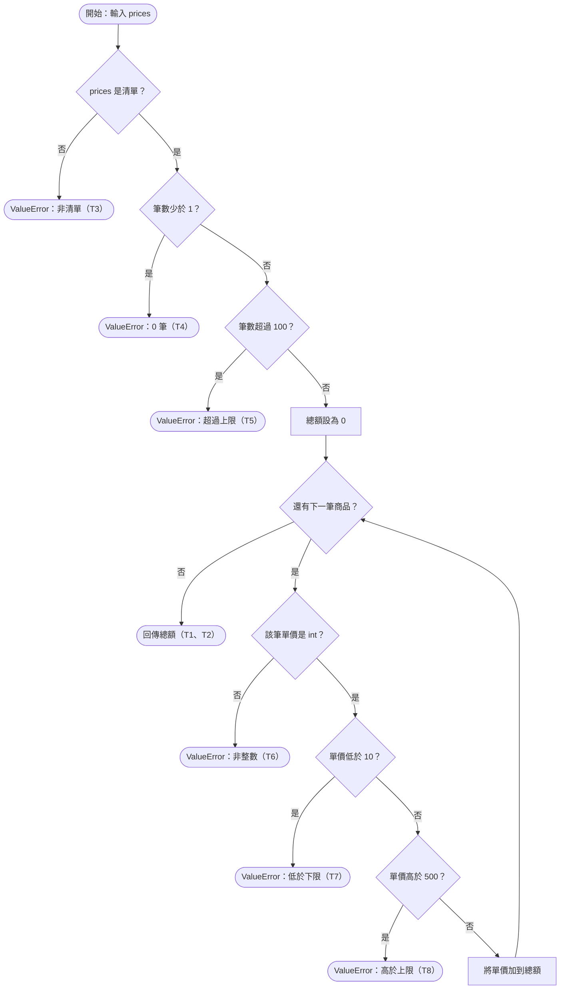

# 作業四｜Stress Testing Coverage

組別：＿＿＿＿　組長：＿＿＿＿　組員：＿＿＿＿

## 1. 測試目標與有效範圍

測試購物車金額函式 `checkout_total(prices)`。依作業規格，檢查有效範圍內的最低單價、最高單價、最少筆數及最多筆數，並驗證六種無效輸入。全部共 10 個涵蓋目標。

| 資料 | 有效條件 | 無效類別 |
| --- | --- | --- |
| 購物車型別 | Python `list` | 非清單 |
| 商品筆數 | 1～100 筆，含兩端 | 0 筆、超過 100 筆 |
| 每筆單價 | 10～500 元的整數，含兩端 | 非整數、低於 10、高於 500 |

有效購物車回傳所有單價的總和。函式依序驗證清單型別、筆數，再逐筆驗證單價，遇到第一個錯誤就拋出對應的 `ValueError`。單價使用 `type(price) is int` 的型別規則，因此浮點數與布林值都歸入非整數類別。

## 2. 待測程式與流程

函式本體有 16 行可執行敘述，包含 `if` 條件判斷及 `for` 迴圈。 [待測程式](https://github.com/alanlu01/software-normalize/blob/main/hw4/checkout.py)

```python
def checkout_total(prices: list[int]) -> int:
    if not isinstance(prices, list):
        raise ValueError("prices must be a list")
    if len(prices) < 1:
        raise ValueError("at least 1 item is required")
    if len(prices) > 100:
        raise ValueError("at most 100 items are allowed")
    total = 0
    for price in prices:
        if type(price) is not int:
            raise ValueError("price must be an integer")
        if price < 10:
            raise ValueError("price must be at least 10")
        if price > 500:
            raise ValueError("price must be at most 500")
        total += price
    return total
```

流程圖中的 T1～T8 對應下一節的測試案例。



## 3. 測試案例

| 案例 | Input values | Expected result | Test program’s result | Criteria analysis |
| --- | --- | --- | --- | --- |
| T1 | `[10]` | `10` | `10` | 有效最少筆數 1、有效最低單價 10。 |
| T2 | `[500] * 100` | `50000` | `50000` | 有效最多筆數 100、有效最高單價 500。 |
| T3 | `"10"` | `ValueError: prices must be a list` | `ValueError: prices must be a list` | 購物車型別錯誤。 |
| T4 | `[]` | `ValueError: at least 1 item is required` | `ValueError: at least 1 item is required` | 商品筆數低於下限。 |
| T5 | `[10] * 101` | `ValueError: at most 100 items are allowed` | `ValueError: at most 100 items are allowed` | 商品筆數高於上限，單價維持有效。 |
| T6 | `[10.5]` | `ValueError: price must be an integer` | `ValueError: price must be an integer` | 商品單價為浮點數。 |
| T7 | `[9]` | `ValueError: price must be at least 10` | `ValueError: price must be at least 10` | 單價低於下限，筆數與單價型別維持有效。 |
| T8 | `[501]` | `ValueError: price must be at most 500` | `ValueError: price must be at most 500` | 單價高於上限，筆數與單價型別維持有效。 |

## 4. 涵蓋率與最少案例數

- **有效極值至少需要 2 例。** 同一份清單無法同時有 1 筆和 100 筆。T1、T2 分別命中兩個筆數極值，並合併測到兩個單價極值。
- **六種無效類別至少需要 6 例。** 每次呼叫在第一個驗證錯誤就停止，只會出現一種錯誤結果。T3～T8 分別觸發六個錯誤出口。
- **最少共 8 例，涵蓋率為 10/10（100%）。** 兩個有效案例涵蓋四個有效極值，六個無效案例各涵蓋一種無效類別。

## 5. 工具驗證

### 環境與指令

實測環境為 Python 3.14.5、pytest 9.1.1、pytest-cov 7.1.0 與 coverage.py 7.16.2。從專案根目錄建立虛擬環境並安裝依賴。

```sh
python3 -m venv .venv
source .venv/bin/activate
python -m pip install -r requirements.txt
```

Windows PowerShell 使用 `py -m venv .venv`，後續以 `.\.venv\Scripts\python.exe` 取代各指令中的 `python`。

### HW4 完整測試

```sh
python -m pytest hw4 -v --cov-branch --color=no
```

終端輸出節錄如下。

```text
hw4/test_stress_coverage.py::test_valid_extremes[T1] PASSED              [ 12%]
hw4/test_stress_coverage.py::test_valid_extremes[T2] PASSED              [ 25%]
hw4/test_stress_coverage.py::test_invalid_inputs[T3] PASSED              [ 37%]
hw4/test_stress_coverage.py::test_invalid_inputs[T4] PASSED              [ 50%]
hw4/test_stress_coverage.py::test_invalid_inputs[T5] PASSED              [ 62%]
hw4/test_stress_coverage.py::test_invalid_inputs[T6] PASSED              [ 75%]
hw4/test_stress_coverage.py::test_invalid_inputs[T7] PASSED              [ 87%]
hw4/test_stress_coverage.py::test_invalid_inputs[T8] PASSED              [100%]

Name              Stmts   Miss Branch BrPart  Cover   Missing
-------------------------------------------------------------
hw4/checkout.py      17      0     14      0   100%
-------------------------------------------------------------
TOTAL                17      0     14      0   100%
Required test coverage of 100.0% reached. Total coverage: 100.00%
============================== 8 passed in 0.04s ===============================
```

8 例全部通過。測試比對有效案例的回傳值，並比對無效案例的例外型別與訊息。工具報表顯示 17 個程式敘述與 14 個分支出口皆有執行。Stress Testing 的 10/10 個目標依第 3 節的案例表核對。 [測試程式](https://github.com/alanlu01/software-normalize/blob/main/hw4/test_stress_coverage.py)

### HTML 涵蓋率報表

```sh
python -m pytest hw4 hw5 --cov-branch --cov-report=term-missing --cov-report=html
```

合跑實測為 `12 passed`，`30` 個程式敘述、`18` 個分支出口皆有執行。開啟 `htmlcov/index.html` 後，點選待測檔案可查看逐行標色。終端的 `Missing` 欄列出漏測的行或分支。
