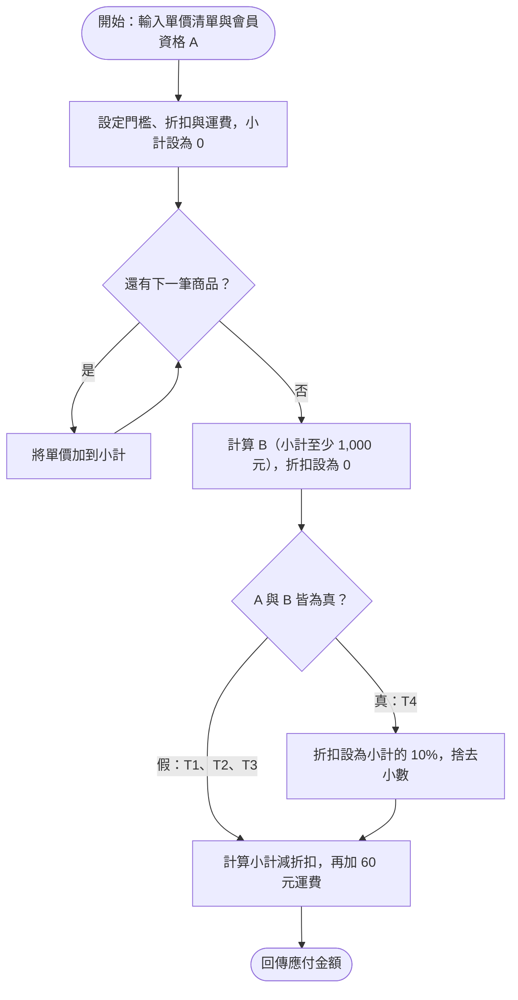

# 作業五｜Logical Expressions Coverage

組別：＿＿＿＿　組長：＿＿＿＿　組員：＿＿＿＿

## 1. 測試目標與折扣規則

測試 `checkout_with_discount(prices, is_member)` 的折扣判斷。函式先以迴圈加總商品單價。當顧客是會員，且購物小計至少為 1,000 元時，折抵小計的 10%，折扣金額無條件捨去至整數。最後加上固定運費 60 元。

| 符號 | 意義 | 何時為真 |
| --- | --- | --- |
| A | `is_member` | 顧客是會員。 |
| B | `meets_threshold` | 商品小計大於或等於 1,000 元。 |
| P | `A & B` | A 與 B 皆為真。 |

兩個運算元皆為布林值。`&` 在這裡執行布林 AND，每次判斷都會評估 A 與 B。測試目標為整體判斷的真假、各子條件的真假、兩個子條件的所有組合。

## 2. 待測程式與流程

函式本體有 12 行可執行敘述，包含加總商品的 `for` 迴圈，以及第 10 行含兩個子條件的 `if` 判斷。 [待測程式](https://github.com/alanlu01/software-normalize/blob/main/hw5/discount.py)

```python
def checkout_with_discount(prices: list[int], is_member: bool) -> int:
    discount_threshold = 1_000
    discount_percent = 10
    shipping_fee = 60
    subtotal = 0
    for price in prices:
        subtotal += price
    meets_threshold = subtotal >= discount_threshold
    discount = 0
    if is_member & meets_threshold:
        discount = subtotal * discount_percent // 100
    discounted_subtotal = subtotal - discount
    return discounted_subtotal + shipping_fee
```



## 3. 測試案例與真值表

| 案例 | Input values（單價清單、會員） | Expected result | Test program’s result | Criteria analysis |
| --- | --- | --- | --- | --- |
| T1 | `[400, 500], False` | 960 元 | 960 元 | 小計 900。A=F、B=F、P=F，折扣 0 元。 |
| T2 | `[500, 700], False` | 1,260 元 | 1,260 元 | 小計 1,200。A=F、B=T、P=F，折扣 0 元。 |
| T3 | `[400, 500], True` | 960 元 | 960 元 | 小計 900。A=T、B=F、P=F，折扣 0 元。 |
| T4 | `[500, 700], True` | 1,140 元 | 1,140 元 | 小計 1,200。A=T、B=T、P=T，折扣 120 元。 |

## 4. 涵蓋率與最少案例數

| 測試準則 | 涵蓋目標 | 最少案例 | 涵蓋率 | 最少案例數的依據 |
| --- | --- | --- | --- | --- |
| Predicate Coverage | P 為真及為假 | T1、T4，共 2 例 | 2/2（100%） | 每次呼叫只有一個 P 結果。T1 使 P 為假，T4 使 P 為真。 |
| Clause Coverage | A 為真及為假，B 為真及為假 | T1、T4，共 2 例 | 4/4（100%） | 每次呼叫為 A、B 各提供一個值。T1 同時測到兩個假，T4 同時測到兩個真。 |
| Combinatorial Coverage | (F,F)、(F,T)、(T,F)、(T,T) | T1～T4，共 4 例 | 4/4（100%） | 兩個獨立布林值有 2 × 2 種組合。每次呼叫只能命中一種。 |

四個案例合起來就能同時達到三種準則的 100%。Combinatorial Coverage 需要全部四例，因此共用集合最少也需要四例。

## 5. 工具驗證

使用 Python 3.14.5、pytest 與 pytest-cov。安裝專案的 `requirements.txt` 後，在專案根目錄執行下列指令。 [測試程式](https://github.com/alanlu01/software-normalize/blob/main/hw5/test_logical_coverage.py)

```sh
python -m pytest hw5 -v --cov-branch
python -m pytest hw5 -v --cov-branch -k "T1 or T4"
```

完整執行 **4 例通過**，程式敘述涵蓋 13/13 行，分支出口涵蓋 4/4。只跑 T1 和 T4 時，**2 例通過**，行與分支涵蓋率也都為 100%。真值表可看出這兩例只涵蓋四種組合中的兩種，Combinatorial Coverage 此時為 50%。
