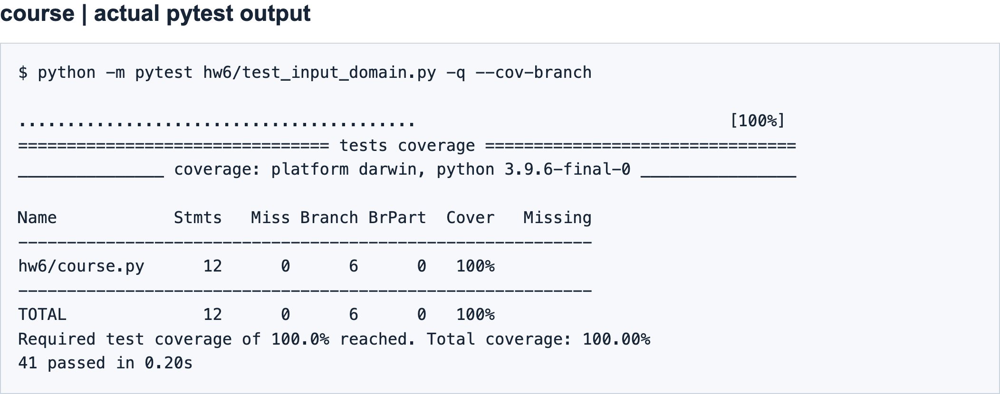
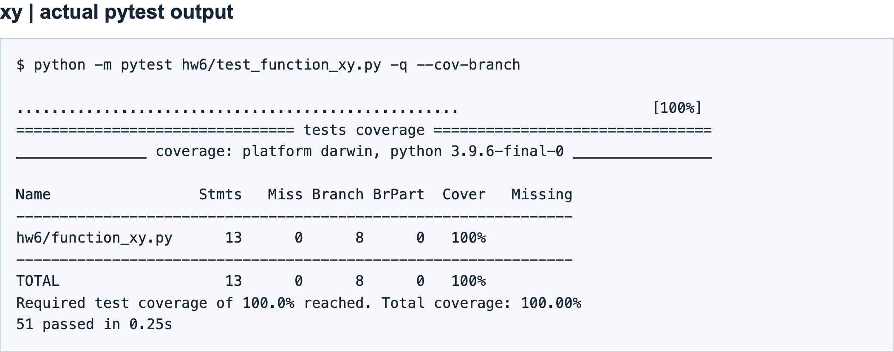
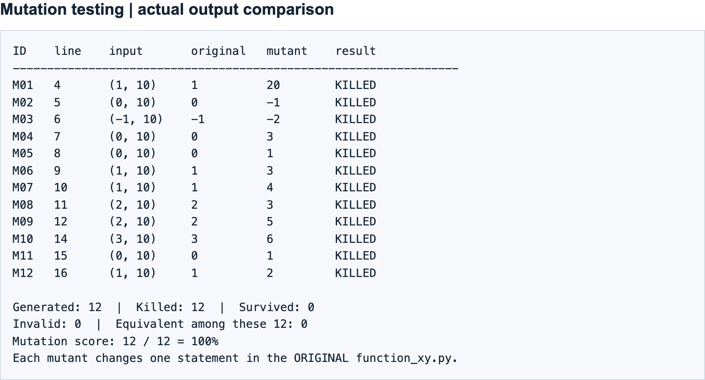
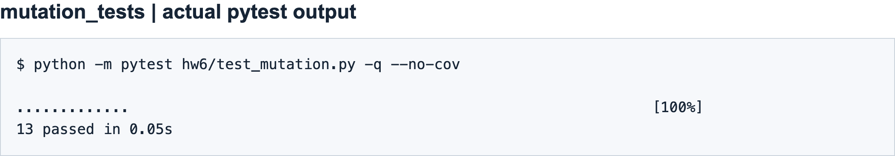
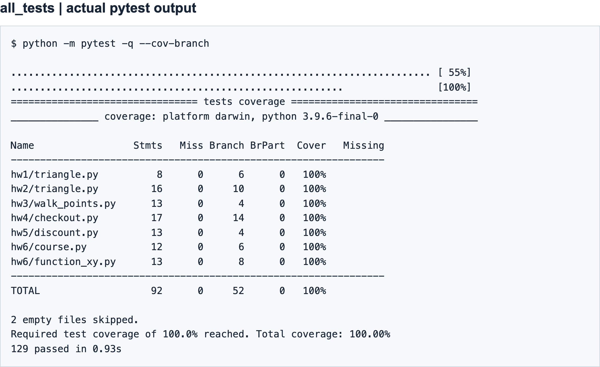

# HW6 完整作業報告

組別：＿＿＿　姓名：＿＿＿　學號：＿＿＿

本次完成題目 5 Input Domain Characterization 的兩組範例，以及題目 6 Mutation Testing Coverage。
日期依課堂題目：第 5 題為 11/20（碩士）、11/14（碩專）；第 6 題為 11/20（碩士）、11/21（碩專）。
原專案 HW5 為邏輯運算式測試，因此本次第 5、6 題統一收在 hw6。

## 完成結果

| 項目 | 功能案例或檢查數 | 結果 |
| --- | ---: | --- |
| 課程 Categorization | 4 | 10/10 類別 |
| 課程 Combinatorial | 36 | 36/36 組合 |
| F(X,Y) Categorization | 5 | 8/8 值類別 |
| F(X,Y) Combinatorial | 15 | 15/15 不同輸入組合 |
| 題目 2×5×3 的補充觀察檢查 | 30 | X、Y 兩種觀察焦點各跑 15 組 |
| Mutation testing | 12 個變異版本 | 12/12 被殺死，100% |
| HW6 自動化測試 | 105 | 全部通過 |
| 全專案回歸測試 | 129 | 全部通過 |

HW6 的 105 項包含課程 40 個案例、F(X,Y) 50 個案例、12 個變異案例，以及 3 項測試設計／變異結構檢查。

## 題目 5 第一組 課程資料

`course.py` 的 summarize_course 接收等級、科系及學生名單，回傳大寫科系加等級的課程代碼、學生人數、人數分類與名單副本，且不修改輸入。

| 特性 | 類別 | 代表值 |
| --- | --- | --- |
| Level of course | 600、700、800 | 600、700、800 |
| Major | swe、cs、isa、infs | 同左 |
| Number of students | 0、1、>1 | 0、1、3 |

人數 0 回傳 empty，1 回傳 single，>1 回傳 multiple。學生名單依人數使用 []、[S001]、[S001,S002,S003]。
三個特性可自由組合；未知等級、科系、錯誤型別不在本題有效輸入規格內。

### 5-1 Categorization

| 案例 | 等級 | 科系 | 人數 | 預期代碼 | 預期分類 | 實測 |
| --- | --- | --- | --- | --- | --- | --- |
| CAT01 | 600 | swe | 3 | SWE-600 | multiple | PASS |
| CAT02 | 700 | cs | 0 | CS-700 | empty | PASS |
| CAT03 | 800 | isa | 1 | ISA-800 | single | PASS |
| CAT04 | 600 | infs | 3 | INFS-600 | multiple | PASS |

至少需要 max(3,4,3)=4 例，因一次呼叫只涵蓋一個科系。四例涵蓋等級 3/3、科系 4/4、人數 3/3，共 10/10 類別；僅涵蓋 4/36 種完整組合。

### 5-2 Combinatorial

全部組合為 3×4×3=36。每次呼叫只能命中一組，所以最少 36 例。每例也比對回傳人數、名單與輸入未被修改。

| 案例 | 等級 | 科系 | 人數 | 預期代碼 | 預期分類 | 實測 |
| --- | --- | --- | --- | --- | --- | --- |
| COM01 | 600 | swe | 0 | SWE-600 | empty | PASS |
| COM02 | 600 | swe | 1 | SWE-600 | single | PASS |
| COM03 | 600 | swe | 3 | SWE-600 | multiple | PASS |
| COM04 | 600 | cs | 0 | CS-600 | empty | PASS |
| COM05 | 600 | cs | 1 | CS-600 | single | PASS |
| COM06 | 600 | cs | 3 | CS-600 | multiple | PASS |
| COM07 | 600 | isa | 0 | ISA-600 | empty | PASS |
| COM08 | 600 | isa | 1 | ISA-600 | single | PASS |
| COM09 | 600 | isa | 3 | ISA-600 | multiple | PASS |
| COM10 | 600 | infs | 0 | INFS-600 | empty | PASS |
| COM11 | 600 | infs | 1 | INFS-600 | single | PASS |
| COM12 | 600 | infs | 3 | INFS-600 | multiple | PASS |
| COM13 | 700 | swe | 0 | SWE-700 | empty | PASS |
| COM14 | 700 | swe | 1 | SWE-700 | single | PASS |
| COM15 | 700 | swe | 3 | SWE-700 | multiple | PASS |
| COM16 | 700 | cs | 0 | CS-700 | empty | PASS |
| COM17 | 700 | cs | 1 | CS-700 | single | PASS |
| COM18 | 700 | cs | 3 | CS-700 | multiple | PASS |
| COM19 | 700 | isa | 0 | ISA-700 | empty | PASS |
| COM20 | 700 | isa | 1 | ISA-700 | single | PASS |
| COM21 | 700 | isa | 3 | ISA-700 | multiple | PASS |
| COM22 | 700 | infs | 0 | INFS-700 | empty | PASS |
| COM23 | 700 | infs | 1 | INFS-700 | single | PASS |
| COM24 | 700 | infs | 3 | INFS-700 | multiple | PASS |
| COM25 | 800 | swe | 0 | SWE-800 | empty | PASS |
| COM26 | 800 | swe | 1 | SWE-800 | single | PASS |
| COM27 | 800 | swe | 3 | SWE-800 | multiple | PASS |
| COM28 | 800 | cs | 0 | CS-800 | empty | PASS |
| COM29 | 800 | cs | 1 | CS-800 | single | PASS |
| COM30 | 800 | cs | 3 | CS-800 | multiple | PASS |
| COM31 | 800 | isa | 0 | ISA-800 | empty | PASS |
| COM32 | 800 | isa | 1 | ISA-800 | single | PASS |
| COM33 | 800 | isa | 3 | ISA-800 | multiple | PASS |
| COM34 | 800 | infs | 0 | INFS-800 | empty | PASS |
| COM35 | 800 | infs | 1 | INFS-800 | single | PASS |
| COM36 | 800 | infs | 3 | INFS-800 | multiple | PASS |



## 題目 5 第二組 F(X,Y)

題目只指定參數與值類別，未指定 F 的計算規格。本作業採以下可驗證函式，並以同一函式進行變異測試：

- X 為整數，分為 <0、0、1、2、>2，代表值 -1、0、1、2、3。
- Y 為 10、20、30。
- X 各類別的權重依序為 -1、0、1、2、3。
- F(X,Y) = 權重 × (Y // 10)。

```python
# Valid domain: integer x; y is one of 10, 20, 30.
# The output specification is defined in hw6/REPORT.md.
def F(x: int, y: int) -> int:
    scaled = y // 10
    if x < 0:
        weight = -1
    elif x == 0:
        weight = 0
    elif x == 1:
        weight = 1
    elif x == 2:
        weight = 2
    else:
        weight = 3
    result = weight * scaled
    return result
```

### 5-1 Categorization

| 案例 | X | Y | 預期值 | 實測 |
| --- | ---: | ---: | ---: | --- |
| XY-CAT1 | -1 | 10 | -1 | PASS |
| XY-CAT2 | 0 | 20 | 0 | PASS |
| XY-CAT3 | 1 | 30 | 3 | PASS |
| XY-CAT4 | 2 | 10 | 2 | PASS |
| XY-CAT5 | 3 | 20 | 6 | PASS |

至少 max(5,3)=5 例，涵蓋 X 的 5/5 與 Y 的 3/3，共 8/8 個值類別。X 與 Y 是兩個參數，不是第三個輸入特性的兩個取值。

### 5-2 完整組合與題目 30 項的區別

對於 F(X,Y) 每次同時提供 X 和 Y，不同的完整輸入組合為 5×3=15，不能僅因有兩個參數就再乘 2。
題目列出 2×5×3=30；本作業另外建立 30 項觀察檢查，使用 focus={X,Y} 各執行全部 15 組。focus 是測試中繼資料，並未加到 F 的參數。這個 30 項設計是對題目數量的補充實作，並不表示有 30 種不同的 F 輸入，也不是由題目能唯一推導出的第三個因子。

X 焦點額外驗證輸出的正負／零性質；Y 焦點額外驗證相對於 Y=10 的線性倍數。兩組都先比對獨立預期值表。

| 案例 | X | Y | 預期值 | 實測 |
| --- | ---: | ---: | ---: | --- |
| XY-COM01 | -1 | 10 | -1 | PASS |
| XY-COM02 | -1 | 20 | -2 | PASS |
| XY-COM03 | -1 | 30 | -3 | PASS |
| XY-COM04 | 0 | 10 | 0 | PASS |
| XY-COM05 | 0 | 20 | 0 | PASS |
| XY-COM06 | 0 | 30 | 0 | PASS |
| XY-COM07 | 1 | 10 | 1 | PASS |
| XY-COM08 | 1 | 20 | 2 | PASS |
| XY-COM09 | 1 | 30 | 3 | PASS |
| XY-COM10 | 2 | 10 | 2 | PASS |
| XY-COM11 | 2 | 20 | 4 | PASS |
| XY-COM12 | 2 | 30 | 6 | PASS |
| XY-COM13 | 3 | 10 | 3 | PASS |
| XY-COM14 | 3 | 20 | 6 | PASS |
| XY-COM15 | 3 | 30 | 9 | PASS |

30 項觀察檢查明細如下；每項都重新呼叫 F。

| 檢查 ID | X | Y | 預期值 | 實測 |
| --- | ---: | ---: | ---: | --- |
| OBS-X--1-10 | -1 | 10 | -1 | PASS |
| OBS-X--1-20 | -1 | 20 | -2 | PASS |
| OBS-X--1-30 | -1 | 30 | -3 | PASS |
| OBS-X-0-10 | 0 | 10 | 0 | PASS |
| OBS-X-0-20 | 0 | 20 | 0 | PASS |
| OBS-X-0-30 | 0 | 30 | 0 | PASS |
| OBS-X-1-10 | 1 | 10 | 1 | PASS |
| OBS-X-1-20 | 1 | 20 | 2 | PASS |
| OBS-X-1-30 | 1 | 30 | 3 | PASS |
| OBS-X-2-10 | 2 | 10 | 2 | PASS |
| OBS-X-2-20 | 2 | 20 | 4 | PASS |
| OBS-X-2-30 | 2 | 30 | 6 | PASS |
| OBS-X-3-10 | 3 | 10 | 3 | PASS |
| OBS-X-3-20 | 3 | 20 | 6 | PASS |
| OBS-X-3-30 | 3 | 30 | 9 | PASS |
| OBS-Y--1-10 | -1 | 10 | -1 | PASS |
| OBS-Y--1-20 | -1 | 20 | -2 | PASS |
| OBS-Y--1-30 | -1 | 30 | -3 | PASS |
| OBS-Y-0-10 | 0 | 10 | 0 | PASS |
| OBS-Y-0-20 | 0 | 20 | 0 | PASS |
| OBS-Y-0-30 | 0 | 30 | 0 | PASS |
| OBS-Y-1-10 | 1 | 10 | 1 | PASS |
| OBS-Y-1-20 | 1 | 20 | 2 | PASS |
| OBS-Y-1-30 | 1 | 30 | 3 | PASS |
| OBS-Y-2-10 | 2 | 10 | 2 | PASS |
| OBS-Y-2-20 | 2 | 20 | 4 | PASS |
| OBS-Y-2-30 | 2 | 30 | 6 | PASS |
| OBS-Y-3-10 | 3 | 10 | 3 | PASS |
| OBS-Y-3-20 | 3 | 20 | 6 | PASS |
| OBS-Y-3-30 | 3 | 30 | 9 | PASS |



## 題目 6 Mutation Testing Coverage

原始程式為 function_xy.py 的 F；逐一針對函式內每個可執行敘述產生一次變異。共 12 個位置，涵蓋 7 個賦值、4 個 if/elif 判斷、1 個 return。
函式宣告、註解、空行與 else 標記不另算可獨立變異的函式本體敘述。coverage.py 顯示 13 行，因為它另計函式定義行；不是漏做一個變異。

每個 M01～M12 都從未變異原始碼出發，僅替換一個敘述，沒有累積前一版的變異。判斷式只改條件，保留子敘述；所有變異版本都可編譯及執行。

### 變異位置與殺死案例

| 版本 | 原碼行 | 原敘述 | 變異後 | 輸入 | 原輸出 | 變異輸出 | 結果 |
| --- | ---: | --- | --- | --- | ---: | ---: | --- |
| M01 | 4 | `scaled = y // 10` | `scaled = y + 10` | (1, 10) | 1 | 20 | KILLED |
| M02 | 5 | `if x < 0:` | `if x <= 0:` | (0, 10) | 0 | -1 | KILLED |
| M03 | 6 | `weight = -1` | `weight = -2` | (-1, 10) | -1 | -2 | KILLED |
| M04 | 7 | `elif x == 0:` | `elif x == 1:` | (0, 10) | 0 | 3 | KILLED |
| M05 | 8 | `weight = 0` | `weight = 1` | (0, 10) | 0 | 1 | KILLED |
| M06 | 9 | `elif x == 1:` | `elif x == 2:` | (1, 10) | 1 | 3 | KILLED |
| M07 | 10 | `weight = 1` | `weight = 4` | (1, 10) | 1 | 4 | KILLED |
| M08 | 11 | `elif x == 2:` | `elif x > 2:` | (2, 10) | 2 | 3 | KILLED |
| M09 | 12 | `weight = 2` | `weight = 5` | (2, 10) | 2 | 5 | KILLED |
| M10 | 14 | `weight = 3` | `weight = 6` | (3, 10) | 3 | 6 | KILLED |
| M11 | 15 | `result = weight * scaled` | `result = weight + scaled` | (0, 10) | 0 | 1 | KILLED |
| M12 | 16 | `return result` | `return result + 1` | (1, 10) | 1 | 2 | KILLED |



例如 M02 將 x < 0 改成 x <= 0；輸入 (0,10)，原版走零的類別回傳 0，變異版誤走負數類別回傳 -1，因此被殺死。
每一列的差異都由真實執行取得，沒有以語法錯誤當成成功的變異案例。

### 結構檢查與分數

自動檢查原始碼 AST 的 12 個敘述位置是否各有一個對應變異；逐行比對每個檔案恰好一行不同；再比較各敘述自身的 AST 結構，排除子敘述重複計數，確認只改一個敘述。
針對每個變異先驗證原版符合預期值，再確認變異版輸出不同，並驗證標準 15 組功能測試也能偵測它。

- 產生 12 個、有效 12 個、被殺死 12 個、存活 0 個。
- 這 12 個都已有輸出不同的反例，因此沒有等價變異；不代表已列舉所有可能的變異。
- Mutation score = 12 / (12 - 0) × 100% = 100%。
- 變異檔不納入原始程式行／分支涵蓋率，變異分數獨立計算。



## 執行方式與全部結果

環境：Python 3.9.6、pytest 8.4.2、pytest-cov 6.3.0、coverage.py 7.10.7。
在專案根目錄執行：

```sh
python3 -m venv .venv
.venv/bin/python -m pip install -r hw6/requirements-py39.txt
.venv/bin/python -m pytest hw6 -v --cov-branch
.venv/bin/python -m pytest hw6/test_input_domain.py -v --cov-branch
.venv/bin/python -m pytest hw6/test_function_xy.py -v --cov-branch
.venv/bin/python -m pytest hw6/test_mutation.py -v --no-cov
.venv/bin/python -m pytest -q --cov-branch
```

變異單項用 --no-cov，因為該項以殺死率為目標；原始程式的行／分支門檻由完整測試套件驗證。Windows 可將 .venv/bin/python 改為 .venv\Scripts\python.exe。

重建變異檔及實測紀錄：

```sh
.venv/bin/python tools/generate_mutants.py
.venv/bin/python tools/collect_hw6_evidence.py
```

全部 129 項通過；92/92 行、52/52 分支出口，涵蓋率均為 100%。HW6 兩個原始程式合計 25/25 行、14/14 分支出口。三個測試設計檢查分別屬於課程、F 與變異結構，不混入最少功能案例數。



截圖是將實際 pytest 原始輸出及變異結果顯示於本機網頁後擷取，對應 .txt、.html 與 mutation_results.json 均保留於 evidence。測試涵蓋有限代表值，不宣稱證明所有整數輸入皆正確。

## 結論

輸入領域測試先定義分類，再用最少集合或笛卡兒積選出案例；變異測試則刻意改一個敘述，檢查測試能否分辨錯誤結果。程式碼 100% 涵蓋、輸入組合 100% 涵蓋與本次變異集合 100% 殺死率是不同指標，應分開計算。

原始專案：https://github.com/alanlu01/software-normalize
本次交付：https://github.com/WesleyLee093/hw6
